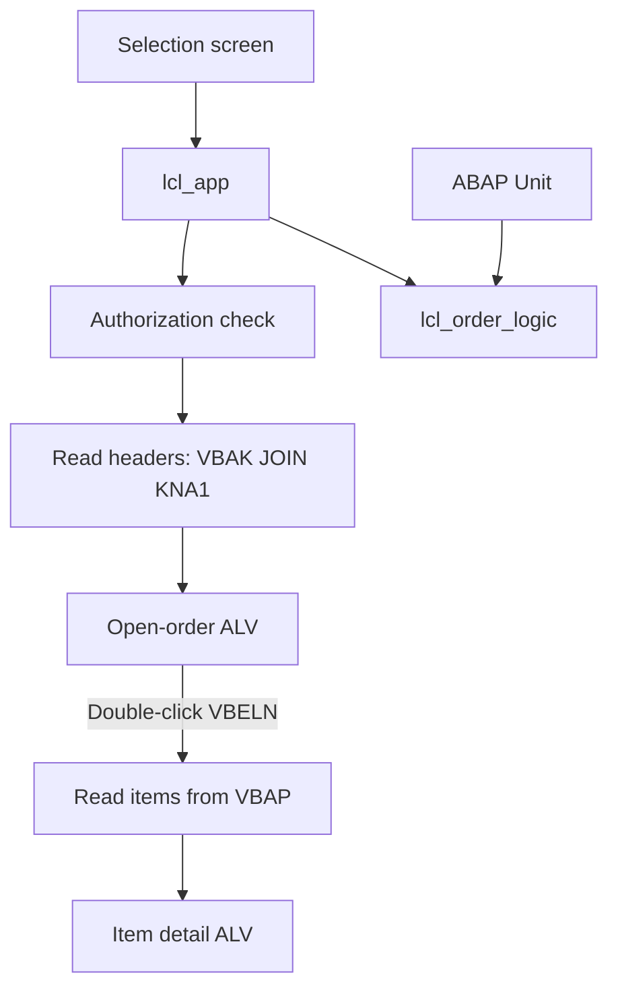

# Sales Order Reporting Suite

A Classic ABAP portfolio project for monitoring open sales orders by customer and drilling down to item details.

## Problem statement

Sales managers need a simple report to review sales orders for a sales organization, identify orders that are not yet completed, and inspect the line items of a selected order.

## Features

- Selection by sales organization, creation date, and customer.
- Header-level report with customer name and order value.
- Open-order filter based on `VBAK-GBSTK` (completed status `C` is excluded).
- Double-click a sales order to display its `VBAP` item details.
- SALV functions, optimized columns, and exception handling.
- Display authorization check for the selected sales organization.
- ABAP Unit tests for the open/completed status rule.
- Open SQL join; no `SELECT *` and no database access inside a loop.

## Technology stack

- SAP S/4HANA 2023 / ABAP Platform 7.58 (target assumption)
- Classic ABAP with 7.40+ syntax
- Open SQL, VBAK, VBAP, KNA1
- `CL_SALV_TABLE`
- ABAP Unit
- abapGit

## Architecture

## Prerequisites

- Access to an SAP S/4HANA system with Classic ABAP development enabled.
- Developer authorization to create and activate a report.
- Display access to `VBAK`, `VBAP`, and `KNA1`.
- The `V_VBAK_VKO` authorization object and its `VKORG` / `ACTVT` fields should be verified in the target system using SU21 before execution. If the system uses a different authorization design, adapt the check with the security team.
- Sales order and customer master data must exist in the client.

## Installation using abapGit

1. Create a Git repository and upload this project folder.
2. In SAP, open the abapGit repository list.
3. Create a new online repository and provide your Git repository URL.
4. Pull the repository into a package you own.
5. Review the imported program object and activate it.
6. If importing the report metadata fails due to a release-specific serializer difference, create the executable program in SE38/ADT and paste the `.prog.abap` source.

## How to run

1. Open `SE38` or ADT.
2. Execute `Z_SALES_ORDER_REPORTING_SUITE`.
3. Enter a sales organization in `P_VKORG`.
4. Optionally enter creation-date and customer ranges.
5. Execute.
6. Double-click a sales order row to open the item list.

## Sample screenshots to capture

Save these under `docs/screenshots/` and link them here when available.

1. `01_selection_screen.png` — report selection screen showing sales organization and optional filters.
2. `02_order_alv.png` — header ALV with sales order, customer, status, and net value columns.
3. `03_item_drilldown.png` — item ALV after double-clicking an order.
4. `04_abap_unit.png` — ABAP Unit runner showing all three tests passing.
5. `05_debugger.png` — debugger stopped in `READ_ORDERS` or `ON_DOUBLE_CLICK`.

## Test instructions

- Run the report with a sales organization that contains sales orders.
- Use date and customer filters to validate selection behavior.
- Double-click an order and compare item rows with `VA03` (display only).
- Run ABAP Unit from ADT or the ABAP Unit tool in the target system.
- Test with a user lacking display authorization for the selected sales organization.
- For a basic performance check, compare execution time for a narrow date range and a broad date range using the same client and data volume. Use ST05/ST12 only if authorized and available.

## Skills demonstrated

ABAP reports, selection screens, DDIC table usage, Open SQL joins, internal tables, modern syntax, modularization with classes and methods, SALV ALV, event handling, authorization checks, exception handling, ABAP Unit, debugging, and basic performance awareness.

## Known limitations

- This is a read-only reporting application; it does not create or change sales orders.
- The definition of “open” is simplified to exclude overall status `C`. Real business rules may also need delivery, billing, rejection, and schedule-line status.
- Header net value is displayed from `VBAK-NETWR`; currency is shown from `VBAK-WAERK`.
- Authorization object availability and field design must be verified in the target system.
- SALV double-click event behavior and report metadata should be validated on the exact SAP_BASIS release.

## Next improvements

- Add delivery and billing status to distinguish partially processed orders.
- Add customer and material search helps or richer selection criteria.
- Add a CDS-based analytical data model and an OData/RAP service as a separate ABAP Cloud variant.
- Add application logging with SLG1 where the business process requires auditability.
- Add ATC/SCI checks and a documented performance baseline.
- Add a dedicated authorization design review with the SAP security team.

## License

Suggested license: MIT. Add the standard MIT `LICENSE` file and replace the copyright holder placeholder with your own details before publishing.

## .gitignore note

A starter `.gitignore` is included. Do not commit credentials, system URLs containing secrets, exported business data, or personal customer information.

## Author

**Geethika Jyothirmayee**  
Aspiring SAP ABAP Developer | SAP Certified – Backend Developer – ABAP Cloud
